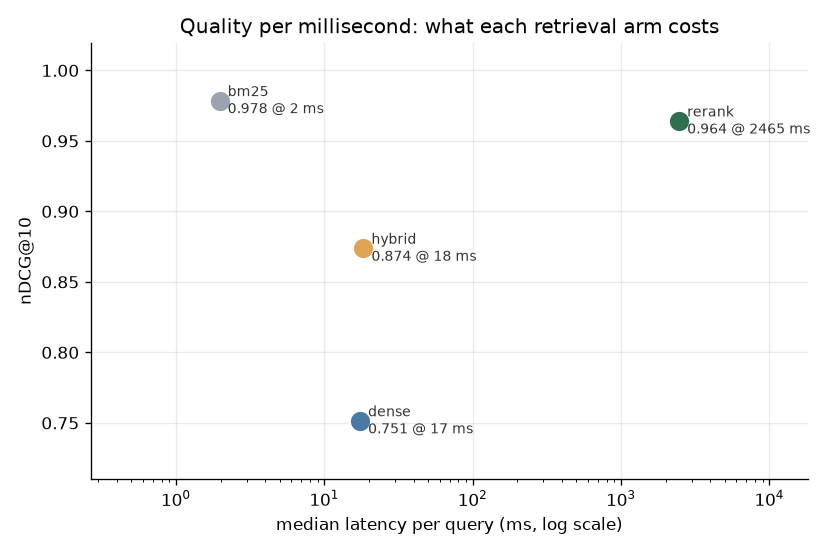
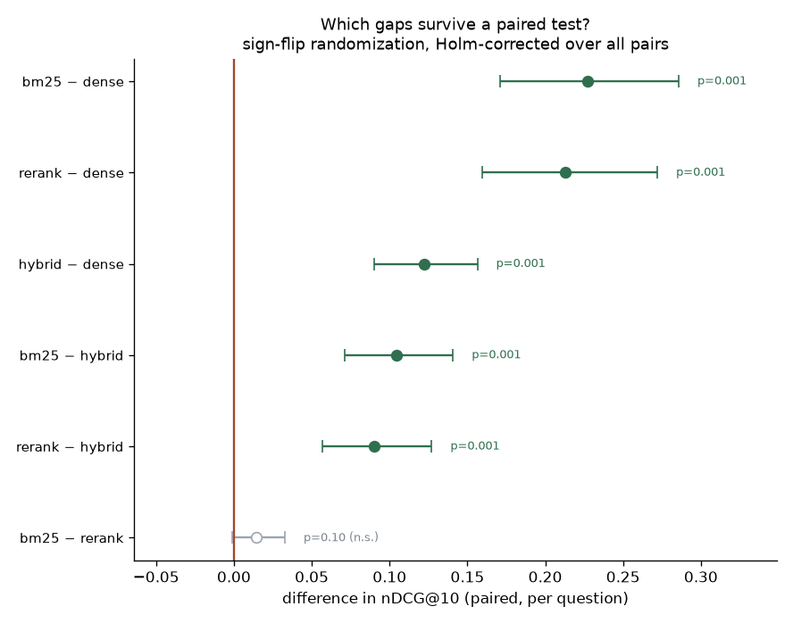
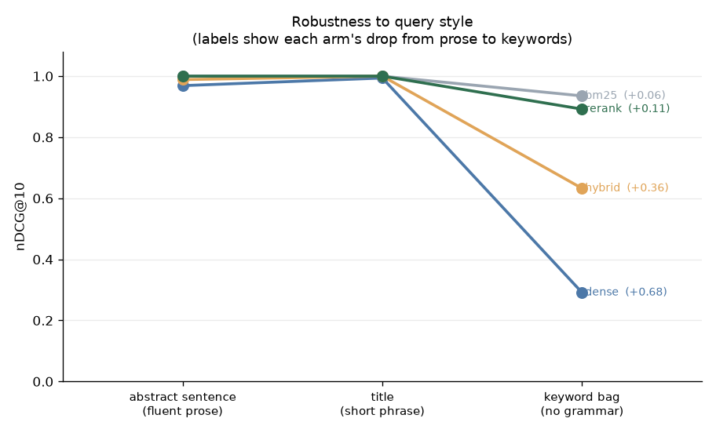
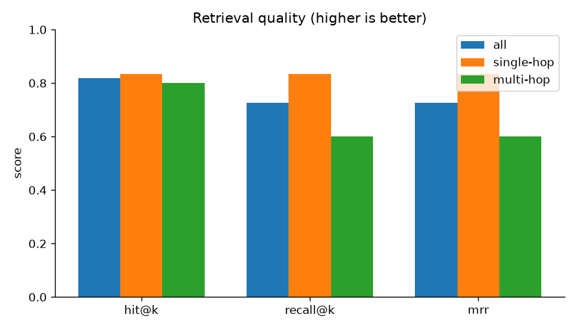
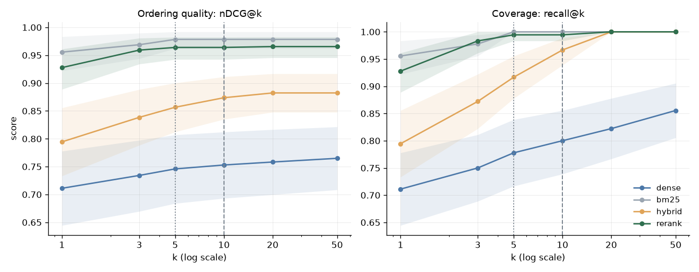
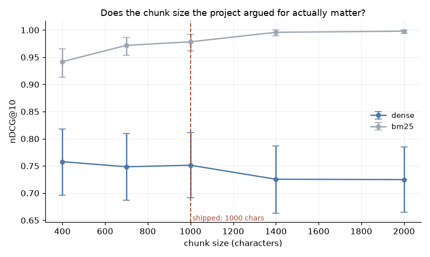
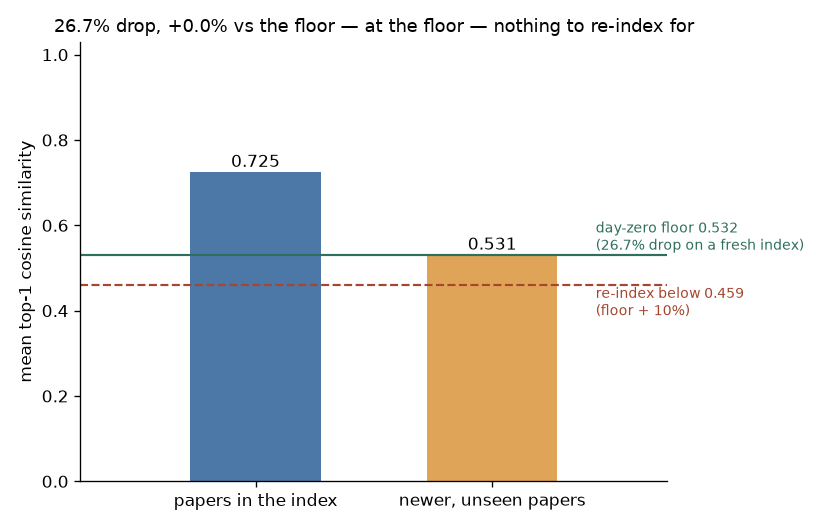

# Agentic RAG Research Assistant

**A 1990s lexical baseline (BM25) beats this system's own embedding retriever on every slice
at one-eighth the latency — nDCG@10 0.978 vs 0.751 — and reranking adds nothing measurable.**

A question-answering system over **2,012 arXiv machine-learning papers** that
retrieves evidence before it answers, cites its sources, and — in its *agentic*
mode — decides for itself how to search: decomposing a question, retrieving
iteratively, and searching again when one pass isn't enough.

This is a **hybrid** project. The **RAG pipeline** (acquire → chunk → embed →
index → retrieve) is the engineering track; it runs end to end, locally, with no
API key. The **retrieval evaluation harness** is the methodology track, and it
**carries the project** — it benchmarks four retrieval strategies against each
other with paired significance tests, sweeps the cutoffs the project committed to,
ablates its own chunking constant, and monitors the index for staleness.

If you have never seen RAG before, [`learning/`](learning/) is a short course
that builds the whole thing from zero — read it alongside the code.

---

## The finding

**The 1990s lexical baseline beats the embedding model this system ships — on
every slice, at one-eighth the latency — and the cross-encoder reranker buys no
measurable quality over it at 1,200× the cost.** Four retrieval strategies, 180
generated known-item queries plus 11 hand-written ones, nDCG@10 with 95%
bootstrap intervals:

| Arm | nDCG@10 | 95% CI | recall@10 | median latency |
|---|--:|:--:|--:|--:|
| **BM25** (lexical, no model) | **0.978** | [0.962, 0.992] | 1.000 | **2.0 ms** |
| Cross-encoder rerank | 0.964 | [0.942, 0.982] | 0.994 | 2,465 ms |
| Hybrid (RRF) | 0.874 | [0.835, 0.911] | 0.967 | 18.3 ms |
| Dense (the shipped retriever) | 0.751 | [0.691, 0.811] | 0.794 | 17.4 ms |



BM25 is the top-left point: **nothing else buys quality it does not already have,
and everything else costs more.**

### Two claims that are stronger than they look

**1. It replicated on a corpus with zero overlap.** These numbers come from an
index rebuilt on 2026-08-12. Of 60 papers sampled from the *previous* corpus, **0
survived** into the new one ([`corpus_turnover.json`](outputs/results/corpus_turnover.json)) —
the recent-2,000-paper window rotates completely in 16 days. The eval set was
regenerated from the new corpus, so this is an out-of-sample re-run, not a
re-report. The previous run is preserved in
[`outputs/results/index_2026-07-27/`](outputs/results/index_2026-07-27/) for
comparison. Every ordering held; `s5` and `m4` (below) reproduced case for case.

**2. The reranker result is a null, correctly stated.** An earlier version of this
README said the cross-encoder "scores lower" than BM25. It doesn't — that reading
came from comparing two marginal intervals, which is not a comparison. Paired
per question, the gap is +0.014 [−0.001, 0.033], **8 wins against 6 losses over
166 ties, p = 0.10 after correction**. The defensible claim is not that BM25 wins;
it is that **the cross-encoder cannot be shown to buy anything, and charges 1,200×
BM25's latency for it.** That is the stronger result — "slightly better" invites an
argument about whether it's worth paying for; "no measurable difference at a
thousand times the price" ends it.

### Is any gap real? The paired tests

Every arm answered the same 180 questions, so the per-question *difference* is
available — and it is a far sharper instrument than four intervals side by side,
because question difficulty cancels in the difference. Sign-flip randomization
test, Holm-corrected across all six pairs:

| Comparison | Δ nDCG@10 | 95% CI | won/lost/tied | p (Holm) | |
|---|--:|:--:|:--:|--:|:--|
| bm25 vs dense | +0.227 | [0.171, 0.286] | 52/1/127 | 0.0006 | ✓ |
| rerank vs dense | +0.213 | [0.160, 0.272] | 51/1/128 | 0.0006 | ✓ |
| hybrid vs dense | +0.122 | [0.090, 0.156] | 46/0/134 | 0.0006 | ✓ |
| bm25 vs hybrid | +0.105 | [0.071, 0.141] | 37/1/142 | 0.0006 | ✓ |
| rerank vs hybrid | +0.090 | [0.057, 0.127] | 34/5/141 | 0.0006 | ✓ |
| **bm25 vs rerank** | +0.014 | [−0.001, 0.033] | 8/6/166 | 0.101 | ✗ |



The wins/losses column carries information the mean cannot: `hybrid vs dense` is
46–0, an arm that never once lost, which is a different thing from an arm that
wins twice enormously. [`src/significance.py`](src/significance.py).

### Why dense loses, and why "just ship BM25" is still wrong

Dense retrieval collapses when a query stops being fluent prose. Across the three
query styles — an abstract sentence, a title, and a shuffled bag of five keywords
— BM25 moves 0.065 while the dense arm loses **two-thirds of its quality**
(0.969 → 0.291):



But on the curated set BM25 has exactly one failure, and it is the one that
matters. Question `s5` asks what **word2vec** learns. The correct paper is
*"Efficient Estimation of Word Representations in Vector Space"* — and the string
`word2vec` appears **zero times in all 4,298 chunks**. BM25 cannot match a term
that is not there and scores 0.00; the dense arm scores 0.387, ranking it around
5th, because *word2vec* and *word representations in vector space* are
near-neighbours in embedding space. That is the canonical vocabulary-mismatch case
dense retrieval was invented for, showing up live in the evaluation — and it
behaved identically on both corpora.

**So the honest recommendation is conditional, not absolute:** ship BM25 for
keyword-shaped queries over a corpus whose vocabulary matches the users' — it is
free and it wins — and keep a dense arm for the terminology-mismatch case it
alone survives. Notably, hybrid RRF does **not** get both: it inherits BM25's
`s5` failure, because fusing a confident-but-wrong ranking with a correct one
pushes the correct document out of the top 10. Fusion is not free insurance.

<details>
<summary><b>The multi-hop finding this project was originally built on</b></summary>

**A single retrieval mostly handles a simple question and structurally fails on a
compound one.** Measured on 11 curated questions with known-correct source papers,
against the shipped dense retriever at `TOP_K = 5`:

| Question type | hit@5 | **recall@5** | MRR |
|---|--:|--:|--:|
| Single-hop (needs 1 paper) | 0.83 | **0.83** | 0.83 |
| **Multi-hop (needs ≥2 papers)** | 0.80 | **0.60** | 0.60 |

On multi-hop questions — the ones that need evidence from two different papers —
single-shot retrieval finds only **60%** of the papers it should. One search
embeds the whole compound question as a single point and lands in one region of
the vector space; the *second* piece of evidence, phrased differently, sits
elsewhere and never surfaces.

**The single-hop miss is worth more than the multi-hop average.** Exactly one
single-hop question fails, and it is `s5` — the word2vec question the benchmark
independently identifies as the vocabulary-mismatch case. The shipped retriever
ranks the right paper around 6th, just outside the five chunks it serves. Two
different measurements, run for different reasons, converge on the same row.



**That 0.83 → 0.60 collapse is the entire motivation for the agent.** The agentic
retriever is built to recover exactly those missed papers: instead of one search,
it decomposes the question and runs a second, focused search for the part the
first one missed. Whether that closes the gap on *answer* quality — and what it
costs in extra retrievals — is the head-to-head the evaluation harness runs
(naive vs agentic, graded by an LLM judge, split by hop type). That comparison
needs an API key to generate; see [What was run vs what was authored](#what-was-run-vs-what-was-authored).

**The benchmark partially vindicates this.** Swapping the retriever fixes some of
the multi-hop gap without any agent at all: on `m4` — the question that missed
**both** papers under dense retrieval — BM25 recovers one of the two (0.00 → 0.613
nDCG@10). The remaining half is a genuine two-paper problem no single retrieval
solves, which is still the agent's case to make. This held on both corpora.

</details>

---

## Method

### The RAG pipeline (engineering track)

Six stages, split into build-time (run once) and query-time (per question):

```
ACQUIRE → CHUNK → EMBED → INDEX     ‖     RETRIEVE → GENERATE
\________ run_pipeline.py _________/       \___ ask.py / rag.py ___/
```

- **Acquire** — download recent cs.CL / cs.LG papers from the arXiv API, plus a
  seeded set of 12 seminal papers (Transformer, BERT, RAG, DPR, ReAct, …) so the
  evaluation's ground-truth answers are always present. Provenance (query, date,
  count, SHA-256) is recorded. Pinning those 12 by id is what makes the curated
  questions survive a re-index — the recent slice turns over completely, and they
  do not. [`src/acquisition.py`](src/acquisition.py).
- **Chunk** — overlapping ~1000-char windows carrying each paper's id and title,
  so answers can cite. Size and overlap are argued named constants — and, since
  the ablation below, measured ones. [`src/chunking.py`](src/chunking.py).
- **Embed** — `all-MiniLM-L6-v2`, a local sentence-transformer; vectors are
  L2-normalized so inner product = cosine similarity. No API key, deterministic.
  [`src/embeddings.py`](src/embeddings.py).
- **Index** — an exact FAISS inner-product index, in-process and file-backed. No
  Docker, no server. [`src/vectorstore.py`](src/vectorstore.py).

There is **one** definition of retrieval in the repo — both the naive and agentic
paths call the same `VectorStore.search`, so any difference between them is about
the *strategy*, never an accidental difference in search.

### Naive RAG — the baseline ([`src/rag.py`](src/rag.py))

Retrieve the top-5 chunks once, put them in a grounded prompt ("answer ONLY from
these passages, cite the arXiv ids, say so if they're insufficient"), generate
once. Its weakness is the finding above: one retrieval, one chance.

### Agentic RAG — the system ([`src/agent.py`](src/agent.py))

A from-scratch Claude **tool-use loop** (no framework — explainability is a hard
requirement). Claude is given a `search_corpus` tool and decides how to use it:
decompose the question, search for each part, read what came back, search again if
it's not enough (up to `MAX_AGENT_STEPS = 4`), then answer with citations. Every
query it chooses is logged as a visible reasoning trace — run
`python ask.py --mode agentic "..."` to watch it decompose a question live.

### The retrieval benchmark — four arms ([`src/retrievers.py`](src/retrievers.py))

Each arm is the previous one plus **exactly one idea**, so a change in the score
can be attributed to a cause. An arm that added two things at once would be
unattributable.

| Arm | What it adds | Implementation |
|---|---|---|
| `dense` | semantic matching | delegates to `VectorStore.search` — the *same* code path the shipped system uses, pinned by a test |
| `bm25` | literal term overlap | [`src/lexical.py`](src/lexical.py) — BM25 Okapi written out, ~60 lines, k1/b at the Lucene defaults |
| `hybrid` | fusing the two | reciprocal-rank fusion, `Σ 1/(60 + rank)` — fuses *ranks*, because cosine and BM25 scores share no scale |
| `rerank` | joint query-document reading | cross-encoder over the hybrid shortlist ([`src/rerank.py`](src/rerank.py)) |

BM25 is implemented rather than imported on purpose: it is the baseline the whole
headline claim is measured against, and an imported black box would make it
un-inspectable. It adds no dependency — the sparse count matrix comes from
scikit-learn, already pinned.

### Evaluation — the fair comparison ([`src/evaluation.py`](src/evaluation.py))

- **Ranking metrics** (local, no key): nDCG@10 and MAP alongside hit@k, recall@k
  and MRR. nDCG and MAP grade the *whole ordering*; MRR stops looking after the
  first hit and recall never looks at order at all.
- **Bootstrap intervals.** 2,000 resamples over *questions*, because the question
  set is the sample being generalised over. This is why the eval set was grown:
  on the 11 curated questions BM25's interval is [0.611, 0.962] — wide enough to
  decide nothing, which is the honest reading of 11 rows.
- **Paired significance tests** ([`src/significance.py`](src/significance.py)) —
  the comparison the intervals above cannot make. See the finding.
- **Latency**, measured after a per-arm warm-up. The first dense call pays a
  one-off model load of tens of seconds; including it would not make an arm look
  slow, it would make the measurement wrong.
- **Answers** (LLM-as-judge, key-gated + cached): groundedness and correctness,
  naive vs agentic, split single-hop vs multi-hop, plus the agent's retrieval
  count so the quality gain is weighed against its token cost.

Everything is held constant except the strategy — same corpus, same chunks in the
same row order, same questions, same judge — so the comparison is honest.

### The evaluation set ([`eval/ADJUDICATION.md`](eval/ADJUDICATION.md))

Two sets, built differently, **reported separately and never averaged**:

- **11 hand-written questions** — the only genuine multi-hop slice, and the
  control: written by a person in their own words, so they do not inherit the
  generated set's construction bias. Their targets are the pinned seminal papers,
  which is why they survived the re-index unchanged.
- **180 generated known-item queries** — 60 papers × three query styles, seeded
  and deterministic, regenerated whenever the corpus is rebuilt. The query is
  manufactured *from* the document it points to, so the relevance judgement is a
  matter of record rather than opinion.

The first version of the generated set used only abstract sentences and was
useless — every arm scored ~1.00, because a sentence lifted from an abstract is a
literal substring of the passage it targets. The `keyword` style exists to break
that, and the gradient between the styles turned out to be the more interesting
measurement. `ADJUDICATION.md` states what the labels are worth and where they
mislead.

### Where should the cutoff be? The k-sweep

`TOP_K = 5` is what the system feeds the LLM, `EVAL_K = 10` is what the benchmark
reports, `RERANK_CANDIDATES = 50` is how deep the reranker's shortlist goes. All
three were argued in config and none was measured. Sweeping k for every arm — one
search at k=50, then truncated, so the *cutoff* is the only thing varying:



| recall@k | k=1 | k=5 | k=10 | k=20 | k=50 |
|---|--:|--:|--:|--:|--:|
| bm25 | 0.956 | **1.000** | 1.000 | 1.000 | 1.000 |
| rerank | 0.928 | 0.994 | 0.994 | 1.000 | 1.000 |
| hybrid | 0.794 | 0.917 | 0.967 | **1.000** | 1.000 |
| dense | 0.711 | 0.778 | 0.800 | 0.822 | **0.856** |

Three answers no fixed-k table could give:

1. **Serving 5 costs nothing under BM25** — recall is already 1.000 there, so the
   gap between the served cutoff and the reported one hides no losses. Under the
   dense arm it would (0.778 vs 0.800).
2. **The dense arm never saturates.** At k=50 it has found 85.6% of the targets.
   That is a **recall ceiling**, not a ranking problem — and it is the mechanical
   reason the reranker cannot rescue it: a cross-encoder reorders what it is
   handed and cannot retrieve what the first stage never returned.
3. **The reranker's shortlist is over-provisioned.** Hybrid recall reaches 1.000
   by k=20, so nothing after rank 20 is ever needed. `RERANK_CANDIDATES` could be
   20 instead of 50 — about 2.5× less cross-encoder work at no cost in recall.

### Was the chunk size worth arguing about? The ablation

`CHUNK_SIZE_CHARS = 1000` carries a paragraph of justification — too large and one
vector must average several ideas, too small and a sentence loses the context that
made it meaningful — and, until this run, no measurement.
[`run_ablation.py`](run_ablation.py) rebuilds the corpus at five sizes (re-chunk,
re-embed, re-index each time) and scores dense and BM25 on the same questions.



| chunk size | chunks | dense nDCG@10 | bm25 nDCG@10 |
|--:|--:|--:|--:|
| 400 | 9,810 | 0.758 | 0.942 |
| 700 | 5,895 | 0.748 | 0.972 |
| **1000 (shipped)** | 4,298 | 0.751 | 0.978 |
| 1400 | 3,388 | 0.726 | 0.996 |
| 2000 | 2,082 | 0.725 | 0.998 |

Read as point estimates, dense looks like it prefers 400 and BM25 like it prefers
2000 — two arms wanting opposite things. Paired against the shipped setting, with
Holm correction, only half of that survives:

| arm | vs 1000 | Δ nDCG@10 | better/worse/tied | p (Holm) | |
|---|--:|--:|:--:|--:|:--|
| dense | 400 | +0.007 | 12/12/156 | 1.00 | ✗ |
| dense | 1400 | −0.026 | 8/17/155 | 0.18 | ✗ |
| dense | 2000 | −0.026 | 10/19/151 | 0.23 | ✗ |
| bm25 | 400 | −0.037 | 2/17/161 | 0.0004 | ✓ |
| bm25 | 1400 | +0.018 | 8/1/171 | 0.050 | ✓ (borderline) |
| bm25 | 2000 | +0.020 | 8/0/172 | 0.026 | ✓ |

**Chunk size matters to BM25 and not measurably to the dense arm** — which is the
opposite of the argument the constant was written with, since that argument was
entirely about embedding dilution. Not one dense setting differs significantly
from the default; the apparent preference for 400 is 12 wins against 12 losses.

The mechanism on the BM25 side is worth stating because it is not the usual one:
BM25 scores *documents*, and chunking splits a paper's term mass across several of
them, so each chunk matches fewer of the query's terms while the ground truth
stays per-paper. Fragmentation is the cost, and larger windows pay less of it.

**The honest caveat:** at 2,000 characters the corpus is barely chunked at all —
2,082 chunks for 2,012 papers, because an abstract *is* about one chunk long. So
"BM25 prefers 2000" really means "BM25 would rather these abstracts were not
chunked", which is a statement about short documents, not a general result about
chunking. The defensible conclusion is narrower and more useful: **1000 is a fine
default for the dense arm and a mildly expensive one for the lexical arm, and
nothing about the current value needs changing unless BM25 becomes the first
stage — in which case raising it is worth ~0.02 nDCG.**

### Drift — the metric that was wrong, and how acting on it proved it

Every number here describes an index built on a particular day, and arXiv does not
stop. The probe compares mean top-1 similarity for queries about **indexed**
papers against queries about **newer, unseen** ones, and triggers a re-index when
the drop is large.

On 2026-07-27 it read **27.2%** against a flat 15% trigger, so the project
recommended re-indexing. **Then the project re-indexed — and the same probe, on an
index one hour old, read 26.7%.**



The largest freshness intervention available moved the metric by half a
percentage point, which means it was never measuring staleness. A baseline query
is a sentence lifted verbatim out of a document *in* the index, so its top-1 match
is a near-self-match by construction; a probe query's document is absent by
definition. That gap is a property of **the measurement**, present in full on day
zero, and a threshold on it fires on every index, always.

So the trigger now tests the **excess over a measured day-zero floor** (0.267,
observed on the fresh index rather than assumed). The current reading is
**+0.05 percentage points — no re-index**. The floor is the most fragile constant
in the project: change the embedder, chunk size or corpus size and it silently
stops meaning anything, which is written next to it in
[`src/config.py`](src/config.py).

Worth noting where the bug was hiding: [`src/drift.py`](src/drift.py)'s own
docstring always said "the gap *widening* is the signal", and the code
thresholded the level anyway. The prose was right and unread; the code was wrong
and trusted. A second bug surfaced the same day — the cached probe slice was
reused without re-checking it against the index, so after a re-index it would have
compared the index against its own contents and pronounced it healthy. That one
had been *written down as a known limitation* rather than recognised as a defect.

---

## Results

| | |
|---|---|
| Papers in corpus | 2,012 (2,000 recent + 12 seeded seminal) |
| Chunks indexed | 4,298 |
| Embedding dim | 384 (all-MiniLM-L6-v2) |
| Eval questions | 180 generated known-item + 11 hand-written |
| Retrieval arms benchmarked | 4 (dense, BM25, hybrid RRF, cross-encoder) |
| Pipeline build time | ~5 min on CPU |
| **Best arm** | **BM25 — nDCG@10 0.978 [0.962, 0.992], 2.0 ms** |
| Shipped dense arm | nDCG@10 0.751 [0.691, 0.811], 17.4 ms |
| Cost of the cross-encoder | 1,200× BM25's latency for **no significant gain** (p = 0.10) |
| Corpus turnover in 16 days | 0 of 60 sampled papers survived |
| Index staleness | +0.05pp over the day-zero floor — no re-index |

Every number above is local, keyless, and reproduces offline from
`outputs/results/`. The naive-vs-agent *answer* comparison is the one designed
experiment still outstanding; its numbers need an `ANTHROPIC_API_KEY` once and
are then cached.

### Limitations

- **The generated queries are built from their target documents' own words.**
  That structurally favours BM25, and any absolute claim like "BM25 achieves 0.98"
  is a statement about the construction as much as about BM25. Three things make
  it survivable: the three query styles measure the *slope* rather than a single
  point, the hand-written set — which does not share the bias — agrees, and the
  whole result replicated on a corpus with zero paper overlap. See
  [`eval/ADJUDICATION.md`](eval/ADJUDICATION.md).
- **Known-item retrieval is the easy end of the problem.** One right answer,
  no ambiguity, no near-duplicates that are *almost* right. Absolute scores here
  flatter every arm; the ranking *between* arms is what the set is for.
- **The curated set is still 11 questions.** Its bootstrap intervals overlap
  completely ([0.611, 0.962] for BM25), so it can corroborate the generated set's
  ordering but cannot establish one on its own. It is also too small for the
  paired test to have useful power, which is why significance is reported on the
  generated set only.
- **The drift trigger has been evaluated at two points in time.** Excess-over-floor
  is the right *shape* of test; two readings are not a trend. What would justify
  the tolerance is a series of probes over months, which this project does not
  have and does not claim.
- **One corpus, one embedding model, one CPU.** Nothing here says BM25 beats
  dense retrieval in general — it says it does on 2,012 arXiv abstracts with
  `all-MiniLM-L6-v2`. A stronger embedder, or full text instead of abstracts,
  could reverse it.
- **Latency is single-threaded wall-clock on one laptop**, batch size one. A fair
  relative comparison between arms on identical hardware; not a throughput figure
  to plan capacity from. The reranker would improve most with GPU batching.
- **The corpus is abstracts, not full text.** arXiv metadata is licence-safe to
  store; full text would need per-paper licence filtering (the code records each
  paper's licence for exactly this reason). In practice `redistributable_count`
  came back **0** — not one paper in the corpus carried a licence permitting
  full-text storage — so that branch has never selected a paper.
- **LLM-as-judge is a relative comparator, not an absolute score.** It's fair for
  naive-vs-agent (same judge, same rubric); its absolute numbers carry a judge
  bias, acknowledged rather than hidden.
- **No fine-tuning, no production vector DB.** Deliberate scope — the concepts are
  identical to a hosted setup; the ops are out of scope. A pgvector serving layer
  is a clean future extension.
- **Not hardened against prompt injection.** arXiv abstracts are low-risk, but
  retrieved text should be treated as data, not instructions, in any real system
  (see [`learning/10_failure_modes_and_limits.md`](learning/10_failure_modes_and_limits.md)).

---

## What I'd do about it

1. **Switch the first-stage retriever to BM25, keeping a dense fallback.** On this
   corpus the dense arm pays 8× the latency for 0.227 less nDCG, and that gap is
   significant under a paired test with 52 wins to 1 loss. Not a tuning question —
   a default that was never tested, because nothing in the original project
   compared it to anything.
2. **Do not buy the cross-encoder.** 2.5 seconds a query to buy a difference that
   does not survive its own significance test. This is the recommendation an
   earlier version of this README made ("would lift MRR; the obvious next
   iteration") and the benchmark refuted it twice — first on the point estimate,
   then more precisely on the paired test.
3. **If you keep it anyway, cut its shortlist to 20.** Recall saturates there, so
   candidates 21–50 are pure cost.
4. **Keep a dense arm for the vocabulary-mismatch case.** One question in the
   curated set (`s5`, word2vec) is unanswerable by any lexical method because the
   query term appears zero times in the corpus. Rare here and catastrophic when it
   happens, which argues for a fallback rather than a replacement — and *not* for
   naive RRF fusion, which loses the case too.
5. **Do not re-index yet.** The probe is at its floor. The previous version of
   this list said "re-index now" on the strength of a metric that could not have
   said otherwise.
6. **The remaining multi-hop gap is still the agent's case.** `m4` needs two
   papers and no single retrieval strategy returns both. That is the one part of
   the original hypothesis the benchmark did *not* dissolve.

The point of measuring is that the fix follows from the number — including when
the number contradicts what the project was built to believe, and including when
the number itself turns out to be the thing that was wrong.

---

## What was run vs what was authored

Being precise about this matters more than looking impressive.

### Executed and verified

| | |
|---|---|
| `run_pipeline.py` | Downloaded 2,012 papers, built a 4,298-vector FAISS index (2026-08-12) |
| `run_eval.py` (retrieval half) | The 11 curated questions re-scored on the new index — the single/multi-hop table |
| `run_retrieval_bench.py` | **All four arms × 191 questions**, the paired significance tests, the k-sweep and the drift probe — every benchmark number, interval, p-value and latency above is live output |
| `run_ablation.py` | The chunk-size ablation: 5 settings × 2 arms, each a full re-chunk, re-embed and re-index |
| `outputs/figures/` | 04, 05, 06, 07, 08, 09, 10 — all generated from the saved results |
| `pytest` | **98 passed, 1 skipped** — full suite, no API key (LLM and cross-encoder both mocked) |

Every figure and result file in `outputs/` was regenerated against the 2026-08-12
index. The previous index's numbers are kept separately, in
`outputs/results/index_2026-07-27/`, so nothing in the top level is a survivor of
an earlier run.

### Authored, runs with a key

The **answer-quality** half (naive vs agentic generation, LLM-as-judge grading)
is written and unit-tested with a mocked LLM, but generating the actual answers
and grades needs an `ANTHROPIC_API_KEY`. Run `python run_eval.py` with a key set
and it produces `outputs/results/answer_quality.json` plus the answer-quality and
cost figures — then caches every call so the numbers reproduce without a key
thereafter. This is the same "reference-only, load the saved result" convention
the portfolio's Kaggle-GPU notebooks use.

---

## Reproducing it

```bash
python -m venv .venv && .venv/Scripts/activate   # Windows
pip install -r requirements.txt

python run_pipeline.py          # build the index (local, no key, ~5 min)
pytest -q                       # 98 passed, 1 skipped — keyless
python run_retrieval_bench.py   # four arms + significance + k-sweep + drift (~1h, CPU)
python run_ablation.py          # chunk-size ablation (~25 min, CPU)
python run_eval.py              # retrieval metrics (local) + answer eval (needs key)

# ask a question:
python ask.py --mode agentic "How does retrieval-augmented generation combine a retriever with a generator?"
```

The benchmark's runtime is dominated by the cross-encoder arm (~2.5 s per query,
scored twice — once for the arm comparison and once for the sweep). Everything
else is milliseconds.

The generation steps read `ANTHROPIC_API_KEY` from the environment. Never commit
it — `.gitignore` excludes `.env` and keys before the first commit.

---

## Layout

```
src/            acquisition · chunking · embeddings · vectorstore (single source
                of truth for retrieval) · lexical (BM25) · rerank (cross-encoder) ·
                retrievers (the four arms) · rag (naive) · agent (agentic loop) ·
                evalset (generated questions) · evaluation · significance (paired
                tests) · drift · figures · config (every tuned constant, argued)
run_pipeline.py build: acquire → chunk → embed → index
run_retrieval_bench.py  the four arms, paired significance, the k-sweep, drift
run_ablation.py chunk-size ablation — rebuilds the index per setting
run_eval.py     evaluate: retrieval metrics (local) + answer eval (LLM judge)
ask.py          CLI demo — naive or agentic, with the agent's search trace
eval/           qa_set.json (11 hand-written) · known_item_set.json (180 generated)
                ADJUDICATION.md — how both sets were labelled, and where they lie
tests/          chunking, index round-trip, ranking metrics, BM25, the four arms,
                the generated eval set, the agent loop, the paired statistics, the
                cutoff sweep and the drift trigger (mocked LLM and cross-encoder,
                fully keyless)
learning/       a 12-lesson course: RAG from zero → embeddings → chunking →
                vector search → the pipeline → grounding → agents → evaluation →
                benchmarking retrieval
notebooks/      00_..._final.ipynb — the self-contained capstone
outputs/        figures (committed) + results, including index_2026-07-27/ — the
                previous index's numbers, kept so the re-index is checkable
```

### The capstone notebook

[`notebooks/00_agentic-rag-research-assistant_final.ipynb`](notebooks/00_agentic-rag-research-assistant_final.ipynb)
tells the whole story end to end — problem, data, the pipeline, the benchmark, the
significance tests, the sweep, the ablation, the drift correction, and the
naive-vs-agent design — importing from `src/` so it can never disagree with the
scripts. API-backed cells are reference-only (they load cached results), so the
notebook renders and reproduces the retrieval numbers without a key.

## Data

Papers are fetched from the [arXiv API](https://info.arxiv.org/help/api/) at build
time and are **not committed** — `src/acquisition.py` downloads them and records
provenance. arXiv metadata and abstracts are used under arXiv's terms. Code in
this repo is MIT (see [LICENSE](LICENSE)); the licence covers the code only, not
the papers.
